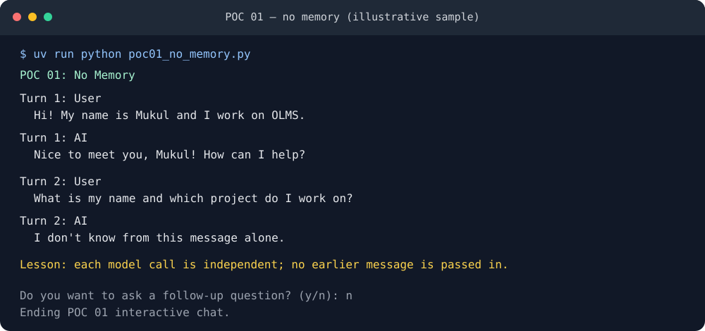

# LLM Memory Mastery with LangChain, LangGraph, and Groq

A beginner-friendly Python project that teaches memory patterns in modern LLM apps using LangChain, LangGraph, and Groq.

## Why this project?

Large language models are stateless by default. To build useful assistants, we need to intentionally add memory layers:

- short-term memory for the current chat
- persistent chat history for a user thread
- long-term memory for durable user facts
- retrieval for relevant facts
- workflow memory for multi-step agent state
- tool memory for search and tool results
- hybrid memory for production systems

This project walks through each concept in small, runnable proof-of-concepts (POCs) so the learning is clear and practical.

The learning path starts with chat history and tool calls, then shows how LangGraph checkpoints tool messages, separates thread state from long-term user memory, and combines the two patterns.

## Prerequisites

- Python 3.11
- uv installed on your machine
- A Groq API key for LLM-backed POCs
- OpenAI API key is not required by the current POCs

## Create a GitHub repo

Create an empty repository under your GitHub account, then run these commands from the project root:

```bash
git init
git branch -M main
git add .
git commit -m "Initial commit"
git remote add origin https://github.com/kansal-mukul/llm-memory-mastery.git
git push -u origin main
```

## Clone a repo

```bash
git clone https://github.com/kansal-mukul/llm-memory-mastery.git
cd llm-memory-mastery
```

## Open in VS Code

```bash
code .
```

## Setup

From the project root:

```bash
uv sync
copy .env.example .env
```

Then edit `.env` and add your keys:

```env
GROQ_API_KEY=your_groq_api_key
```

## Run each POC with uv

From the root directory:

```bash
uv run python poc01_no_memory.py
uv run python poc02_langchain_inmemory_history.py
uv run python poc03_langchain_db_history.py
uv run python poc04_langchain_tool_manully_calling.py
uv run python poc05_langchain_tool_via_create_agent.py
uv run python poc06_langchain_tool__human_in_loop_langgraph_inmemorysaver.py
uv run python poc07_langgraph_inmemory_saver_tool_messages.py
uv run python poc08_langgraph_sqlite_saver_tool_messages.py
uv run python poc09_langgraph_inmemory_store.py
uv run python poc10_sqlite_long_term_memory_custom_store.py
uv run python poc11_langgraph_hybrid_inmemory.py
uv run python poc12_hybrid_sqlite_memory.py
uv run python poc13_langmem_agent_managed_memory.py
uv run streamlit run poc14_streamlit_langmem_sqlite_chatbot.py
```

## POC inputs and outputs

POCs 01–08 and 13–14 call Groq, so their exact assistant wording can vary.
POCs 09–12 use fixed examples and run locally without an LLM call.

| POC | Test input | Expected output / verification | Guide |
| --- | --- | --- | --- |
| 01 — No memory | `Hi! My name is Mukul and I work on OLMS.` then `What is my name and which project do I work on?` | Each model call is independent; the second may not recall the details. | [POC 01](docs/01-no-memory.md) |
| 02 — In-memory history | `My name is Mukul. I work on OLMS.` then `What is my name and which project do I work on?` | The same-session follow-up can use the first turn; memory ends with the process. | [POC 02](docs/02-langchain-inmemory-history.md) |
| 03 — SQLite chat history | In `thread_1`: `My name is Mukul. I work on OLMS.`; in `thread_2`: `What is my name?`; then ask about the name and project in `thread_1`. | The two threads have separate histories, printed from `chat_history.db`. | [POC 03](docs/03-langchain-db-history.md) |
| 04 — Manual tools | `Count the words in this sentence: Manual tool binding gives you full control.`; `Search Wikipedia for information on Marie Curie.` | Prints requested tool and arguments, execution result, and final model answer. | [POC 04](docs/04-langchain-tool-memory.md) |
| 05 — Automatic tools | Ask for an Alan Turing Wikipedia summary, then count `LangChain automation rocks!`. | Agent runs tools automatically; word count is **3**. | [POC 05](docs/05-langchain-create-agent.md) |
| 06 — Human approval | `Summarise who Alan Turing was based on Wikipedia data.` and count `LangChain automation rocks!`; approve/reject with `y`/`n`. | Shows tool request and arguments, then executes or rejects it before answering. | [POC 06](docs/06-langgraph-human-in-the-loop.md) |
| 07 — In-memory checkpoint | `Use the word-count tool for this exact text: LangGraph saves tool messages.` then `What exact word count did the tool return?` | Prints a 4-word tool result and `ToolMessage` entries from the in-memory checkpoint. | [POC 07](docs/07-langgraph-inmemory-saver-tool-messages.md) |
| 08 — SQLite checkpoint | `Use the word-count tool for this exact text: SQLite keeps tool results.` then `What exact word count did the tool return?` | Prints tool messages and checkpoint/write counts in `poc08_checkpoints.db`. | [POC 08](docs/08-langgraph-sqlite-saver-tool-messages.md) |
| 09 — In-memory store | No typed input; saves `I am learning LangGraph memory.` and `I prefer Python examples.` for `learner-1`. | Prints both facts and `0 found` for `learner-2`; data is volatile. | [POC 09](docs/09-langgraph-inmemory-store.md) |
| 10 — SQLite store | No typed input; saves the same two facts for `learner-1`. | Prints facts, `0 found` for `learner-2`, and `poc10_long_term_memory.db`. | [POC 10](docs/10-sqlite-long-term-memory-custom-store.md) |
| 11 — Hybrid in-memory | `Remember: I am learning LangGraph memory.` in `chat-a`, then ask about the learning goal in `chat-b`. | Prints separate thread messages and the shared user fact; both layers are volatile. | [POC 11](docs/11-langgraph-hybrid-inmemory.md) |
| 12 — Hybrid SQLite | `Remember: I prefer Python.` in `chat-a`, then `What language do I prefer?` in `chat-b`. | Prints thread messages and the stored fact; state persists in two SQLite files. | [POC 12](docs/12-hybrid-sqlite-memory.md) |
| 13 — LangMem | `Remember that I prefer concise Python explanations.` then `How should you explain Python concepts to me? Search my saved memories first.` | Prints LangMem tool results and the in-memory stored item. | [POC 13](docs/13-langmem-agent-managed-memory.md) |
| 14 — Streamlit chatbot | Type the short-term, thread-isolation, and long-term prompts in the browser. | Verify chat checkpoints, tool activity, and memories in the sidebar; SQLite persists both layers. | [POC 14](docs/14-streamlit-langmem-sqlite-chatbot.md) |

## Detailed POC runs

These are illustrative terminal examples to help you know what to type and what to look for. They are not recordings from a live API call, so model wording and tool choices can differ when you run them.

### POC 01 — no memory

Run `uv run python poc01_no_memory.py`. The first two questions run automatically. At the follow-up prompt, enter `n` to finish as shown, or enter `y` and ask:

```text
What did I tell you my name and project were?
```

Each question is sent to the model as a separate call without the earlier messages. It may say it does not know, but a model can also guess; that uncertainty is the point of this baseline.



[Open the POC 01 output screenshot](docs/images/poc01-sample.svg)

### POC 02 — in-memory chat history

Run `uv run python poc02_langchain_inmemory_history.py`. The script sends two starter turns in the same session. At the follow-up prompt, enter `n` to finish, or enter `y` and ask:

```text
Can you remind me which project I said I work on?
```

The history is kept in process memory for this run and is lost when the program exits.


[Open the POC 02 output screenshot](docs/images/poc02-sample.svg)

### POC 03 — SQLite-backed threads

Run `uv run python poc03_langchain_db_history.py`. The script demonstrates two separate threads: `thread_1` gets the name and project, while `thread_2` asks for the name without being given it. At the prompt, enter `n` to finish, or continue in either thread by entering its exact ID:

```text
thread_1
What project did I say I work on?
```

Messages are stored in `chat_history.db`. Note: this demo clears `thread_1` and `thread_2` at startup so the first turns are repeatable; it does not demonstrate those same thread IDs surviving a restart.


[Open the POC 03 output screenshot](docs/images/poc03-sample.svg)

### POC 04 — manually executing custom and built-in tools

Run `uv run python poc04_langchain_tool_manully_calling.py`. The script
asks the Groq model to choose between a custom word-count tool and the built-in
LangChain Wikipedia tool.

```text
Count the words in this sentence: Manual tool binding gives you full control.
Search Wikipedia for information on Marie Curie.
```

The model returns a structured tool call. The application looks up the
requested tool in `tool_map`, invokes it with the model-provided arguments,
wraps the result in a `ToolMessage` associated with the original call, and
sends the conversation back to the model for a final answer. Tool selection
and execution are explicit in the application rather than handled by an
automatic agent loop.

[Read the POC 04 guide](docs/04-langchain-tool-memory.md) for the manual
execution flow, sample output, and limitations.

### POC 05 — automatic tool execution with `create_agent()`

Run `uv run python poc05_langchain_tool_via_create_agent.py`. This POC
uses LangChain's `create_agent()` with the same custom word-count and Wikipedia
tools as POC 04. The agent handles the request → tool execution → result →
model loop automatically and returns the final answer to the application.
Set `GROQ_API_KEY` in `.env`; this script loads it with `load_dotenv()`.

[Read the POC 05 guide](docs/05-langchain-create-agent.md) for the execution
flow, comparison with POC 04, sample output, and limitations.

### POC 06 — human approval for tool calls

Run `uv run python poc06_langchain_tool__human_in_loop_langgraph_inmemorysaver.py`.
This POC uses `HumanInTheLoopMiddleware` to pause before every tool call,
prompts for approval or rejection, then resumes the same workflow using
LangGraph's `InMemorySaver` checkpoint and `Command(resume=...)`.

[Read the POC 06 guide](docs/06-langgraph-human-in-the-loop.md) for the
approval, checkpoint, and resumption flow, plus limitations.

### POC 07 — in-memory checkpoints and tool messages

Run `uv run python poc07_langgraph_inmemory_saver_tool_messages.py`. This
continues a tool-using agent in one thread, then inspects its saved
`ToolMessage` state. `InMemorySaver` loses state when the process exits.

[Read the POC 07 guide](docs/07-langgraph-inmemory-saver-tool-messages.md)
for how the agent adds tool results to state and how the checkpointer saves
that state.

### POC 08 — SQLite checkpoints and tool messages

Run `uv run python poc08_langgraph_sqlite_saver_tool_messages.py`. It uses
LangGraph's SQLite checkpointer so thread state can survive a process
restart. Use the same `thread_id` and database file to continue the thread.

[Read the POC 08 guide](docs/08-langgraph-sqlite-saver-tool-messages.md) for
the storage flow, setup, and limitations.

### POC 09 — LangGraph `InMemoryStore`

Run `uv run python poc09_langgraph_inmemory_store.py`. It saves and reads
user-scoped facts using namespaces, without requiring an LLM or API key.

[Read the POC 09 guide](docs/09-langgraph-inmemory-store.md) for how
cross-thread long-term memory differs from checkpointed chat history.

### POC 10 — SQLite long-term memory

Run `uv run python poc10_sqlite_long_term_memory_custom_store.py`. The
example uses LangGraph's `SqliteStore` to persist namespaced facts across
restarts, in the same `put()` / `search()` style as POC 09's `InMemoryStore`.

[Read the POC 10 guide](docs/10-sqlite-long-term-memory-custom-store.md) for
the implementation and its limits.

### POC 11 — hybrid in-memory memory

Run `uv run python poc11_langgraph_hybrid_inmemory.py`. It combines
`InMemorySaver` for one conversation's state with `InMemoryStore` for facts
shared across two threads belonging to the same user.

[Read the POC 11 guide](docs/11-langgraph-hybrid-inmemory.md) for the two
memory scopes and how they fit together.

### POC 12 — hybrid SQLite memory and production path

Run the built-in save-and-recall example across two threads:

```bash
uv run python poc12_hybrid_sqlite_memory.py
```

This combines LangGraph's durable SQLite checkpointer and `SqliteStore` for
thread state and user facts. The script runs a save in `chat-a` and reads the
fact in `chat-b` without requiring command-line arguments. It is still a
local learning sample, not production-ready.

[Read the POC 12 guide](docs/12-hybrid-sqlite-memory.md) for production
architecture requirements and a migration direction.

### POC 13 — agent-managed memory with LangMem

Run `uv run python poc13_langmem_agent_managed_memory.py`. The agent gets
LangMem tools to decide when to save and search long-term user memories,
instead of the application hard-coding those decisions for each turn. The
example uses an in-memory store, so its memories are lost on process exit.

[Read the POC 13 guide](docs/13-langmem-agent-managed-memory.md) for what
LangMem automates, what developers still own, and the limitations.

### POC 14 — Streamlit chatbot with persistent LangMem memory

Set `GROQ_API_KEY` in `.env`, then run:

```bash
uv run streamlit run poc14_streamlit_langmem_sqlite_chatbot.py
```

The browser UI keeps the current conversation in `SqliteSaver` and LangMem
facts in `SqliteStore`. Use **Start a new chat** to create a separate thread;
long-term memories are shared for the demo user. The app creates
`poc14_threads.db` and `poc14_memories.db` in the project directory.

#### Test data

##### 1. Short-term memory in one thread

Click **Start a new chat**, then enter these messages in order:

   ```text
   For this conversation only, my temporary code is TMP-7429. Do not save it as a long-term memory.
   ```

   ```text
   What was my temporary code in this chat?
   ```

   **Verify:** the assistant recalls `TMP-7429` in this thread. Check the
   sidebar to confirm the temporary code was not added to long-term memories.

##### 2. Thread isolation

Click **Start a new chat** again, then enter:

   ```text
   What temporary code did I use in another chat? Don't guess; check my saved memories.
   ```

   **Verify:** it should not recall `TMP-7429` from the previous thread unless
   that code was saved as a long-term memory.

##### 3. Long-term memory across threads

In the chat, enter:

   ```text
   Please save this stable preference: I prefer concise explanations with Python examples.
   ```

   **Verify:** the assistant confirms saving it, LangMem tool activity is
   visible below the reply, and the preference appears in the sidebar's
   **Long-term memories** list.

Click **Start a new chat**, then enter:

   ```text
   How should you explain Python concepts to me? Search my saved memories first.
   ```

   **Verify:** the new thread retrieves the preference and the tool activity
   shows a memory search.

##### 4. Checkpoint persistence after restart

In the default chat (before clicking **Start a new chat**), enter:

   ```text
   For this chat only, my checkpoint test phrase is blue lantern 58. Do not save it as a long-term memory.
   ```

Stop and restart the app, then enter:

   ```text
   What was my checkpoint test phrase in this chat?
   ```

   **Verify:** the default thread can recall the phrase from its checkpoint,
   while the sidebar shows the separate long-term preference. The checkpoint
   database is `poc14_threads.db`; long-term memories are in
   `poc14_memories.db`.

Assistant wording and whether the model follows tool instructions can vary.
The sidebar is the source to verify what is actually stored. The app uses the
same demo user ID for every chat, so **Start a new chat** creates a new thread,
not a separate user.

[Read the POC 14 guide](docs/14-streamlit-langmem-sqlite-chatbot.md) for
the storage details, test data, and limitations. It builds on the in-memory
LangMem pattern in [POC 13](docs/13-langmem-agent-managed-memory.md).

## Project structure

```text
llm-memory-mastery/
├── README.md
├── pyproject.toml
├── uv.lock
├── .env.example
├── .gitignore
├── docs/
│   ├── 01-no-memory.md
│   ├── 02-langchain-inmemory-history.md
│   ├── 03-langchain-db-history.md
│   ├── 04-langchain-tool-memory.md
│   ├── 05-langchain-create-agent.md
│   ├── 06-langgraph-human-in-the-loop.md
│   ├── 07-langgraph-inmemory-saver-tool-messages.md
│   ├── 08-langgraph-sqlite-saver-tool-messages.md
│   ├── 09-langgraph-inmemory-store.md
│   ├── 10-sqlite-long-term-memory-custom-store.md
│   ├── 11-langgraph-hybrid-inmemory.md
│   ├── 12-hybrid-sqlite-memory.md
│   ├── 13-langmem-agent-managed-memory.md
│   ├── 14-streamlit-langmem-sqlite-chatbot.md
│   └── images/
│       ├── poc01-sample.svg
│       ├── poc02-sample.svg
│       ├── poc03-sample.svg
│       └── poc04-sample.svg
├── poc01_no_memory.py
├── poc02_langchain_inmemory_history.py
├── poc03_langchain_db_history.py
├── poc04_langchain_tool_manully_calling.py
├── poc05_langchain_tool_via_create_agent.py
├── poc06_langchain_tool__human_in_loop_langgraph_inmemorysaver.py
├── poc07_langgraph_inmemory_saver_tool_messages.py
├── poc08_langgraph_sqlite_saver_tool_messages.py
├── poc09_langgraph_inmemory_store.py
├── poc10_sqlite_long_term_memory_custom_store.py
├── poc11_langgraph_hybrid_inmemory.py
├── poc12_hybrid_sqlite_memory.py
├── poc13_langmem_agent_managed_memory.py
└── poc14_streamlit_langmem_sqlite_chatbot.py
```

## Learning roadmap

| POC | Focus | Key concept | Why it matters |
| --- | --- | --- | --- |
| 01 | No memory | Stateless model | Understand the baseline problem |
| 02 | In-memory chat | Short-term memory | Session continuity inside one app run |
| 03 | DB-backed chat | Persistent thread memory | Multiple users/threads |
| 04 | Manual tool execution | Explicit tool dispatch and result handoff | Understand the application-managed tool loop |
| 05 | Automatic tool execution | LangChain `create_agent()` loop | Let the agent run tools and return their results |
| 06 | Human-in-the-loop tools | Approve or reject tool calls | Add user control before tool execution |
| 07 | In-memory checkpointer | Tool messages in thread state | See what the saver stores |
| 08 | SQLite checkpointer | Durable thread state | Continue after a restart |
| 09 | In-memory store | User-scoped facts | Share facts across threads |
| 10 | LangGraph SQLite Store | Durable key-value memory | Persist namespaced facts across restarts |
| 11 | Hybrid in-memory | Checkpointer + Store | Separate thread and user memory |
| 12 | Hybrid SQLite | Durable local thread + user memory | Understand production upgrades |
| 13 | LangMem | Agent-managed memory tools | Reduce hand-written save/search decisions |
| 14 | Streamlit + LangMem + SQLite | Persistent chatbot memory | Test durable chat and user memories in a UI |

## Memory types

| Memory type | Where it lives | Best for |
| --- | --- | --- |
| Short-term memory | Chat history in current session | Recent user context |
| Persistent chat history | SQLite or DB chat store | Multi-thread continuity |
| Long-term memory | InMemoryStore or database store | Reused facts like name/project |
| Relevant memory retrieval | Semantic search over stored memories | Fast recall of useful facts |
| Workflow memory | LangGraph checkpointer (Saver) | Multi-step agent state |
| Tool memory | ToolMessage in checkpointed graph state | Preserve tool calls and results in a thread |
| Hybrid memory | Checkpointer + Store | Combine conversation state and user facts |
| Agent-managed memory | LangMem tools over a Store | Delegate routine create/update/search choices to the agent |

## Core memory flow

```text
User message
   ↓
ChatGroq / LangGraph agent
   ↓
Short-term thread memory (Saver or chat history)
   ↓
Relevant memory lookup (Store + semantic search)
   ↓
Tool call or workflow action
   ↓
ToolMessage / workflow output
   ↓
Final answer to user
```

## Troubleshooting

### Groq API issues

- Ensure `.env` exists and contains `GROQ_API_KEY`.
- Confirm the model name is exactly `qwen/qwen3.8-27b`.
- Check that your Groq key is active and not expired.

### POC 06 tool approval issues

- POC 06 uses `GROQ_API_KEY`; it does not require an OpenAI embeddings key.
- Keep the same thread ID when resuming an interrupted invocation.
- Remember that `InMemorySaver` state is lost when the process exits.

### SQLite / DB history issues

- Delete `chat_history.db` if you want a clean state.
- Ensure the file is writable from the project folder.

### LangGraph state issues

- Re-run the same thread ID when testing memory persistence.
- Keep the thread ID constant across turns to see memory behavior.
- `InMemorySaver` and `InMemoryStore` are cleared when the process exits.
- Use a checkpointer for thread state and a Store for cross-thread facts; a
  Store does not automatically save tool messages.

### uv issues

- Run `uv sync` once after pulling the repo.
- Use `uv run python ...` rather than a bare `python` command to use the project environment.

## Production upgrades

For a real production setup, move from in-memory systems to durable storage:

- LangGraph Saver → PostgresSaver
- LangGraph Store → PostgresStore
- Chat history → Postgres or SQLite with proper thread tables
- Long-term memory → vector database with embeddings and semantic search
- Tools → real search APIs and orchestrated workflows

## GitHub commit and push

```bash
git status
git add .
git commit -m "Add LangChain and LangGraph memory project"
git branch -M main
git remote add origin https://github.com/<your-user>/<your-repo>.git
git push -u origin main
```

## Notes

- This project intentionally avoids RAG and document retrieval.
- The focus is memory architecture: not document search, but user-specific memory and agent state.
- Each POC is designed to be simple enough for beginners while still showing real-world patterns.
