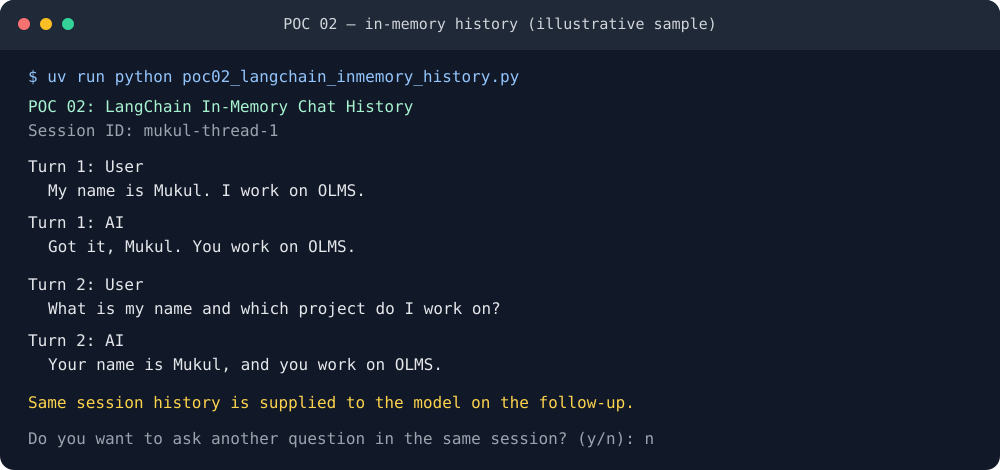
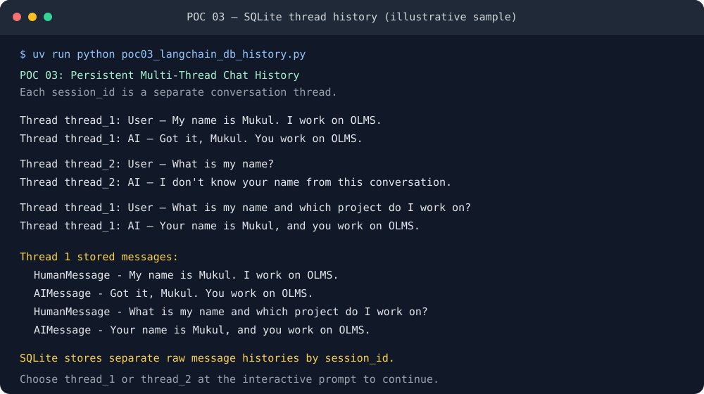

# LLM Memory Mastery with LangChain, LangGraph, and Groq

A beginner-friendly Python project that teaches memory patterns in modern LLM apps using LangChain, LangGraph, and Groq.

## Why this project?

Large language models are stateless by default. To build useful assistants, we need to intentionally add memory layers:

- short-term memory for the current chat
- persistent chat history for a user thread
- long-term memory for durable user facts
- retrieval for relevant facts
- workflow memory for multi-step agent state
- tool memory for search and tool results
- hybrid memory for production systems

This project walks through each concept in small, runnable proof-of-concepts (POCs) so the learning is clear and practical.

The learning path starts with basic chat history, demonstrates the gap between running a tool and saving its result in POC 04, then builds up memory patterns before showing how LangGraph preserves tool messages in POC 10.

## Prerequisites

- Python 3.11
- uv installed on your machine
- A Groq API key
- An OpenAI API key only for POC 06 embeddings

## Create a GitHub repo

Create an empty repository under your GitHub account, then run these commands from the project root:

```bash
git init
git branch -M main
git add .
git commit -m "Initial commit"
git remote add origin https://github.com/kansal-mukul/llm-memory-mastery.git
git push -u origin main
```

## Clone a repo

```bash
git clone https://github.com/kansal-mukul/llm-memory-mastery.git
cd llm-memory-mastery
```

## Open in VS Code

```bash
code .
```

## Setup

From the project root:

```bash
uv sync
copy .env.example .env
```

Then edit `.env` and add your keys:

```env
GROQ_API_KEY=your_groq_api_key
OPENAI_API_KEY=your_openai_api_key
```

## Run each POC with uv

From the root directory:

```bash
uv run python poc01_no_memory.py
uv run python poc02_langchain_inmemory_history.py
uv run python poc03_langchain_db_history.py
uv run python poc04_langchain_tool_manully_calling.py
uv run python poc05_auto_long_term_memory.py
uv run python poc06_relevant_memory_retrieval.py
uv run python poc07_langgraph_saver.py
uv run python poc08_langgraph_store.py
uv run python poc09_langgraph_hybrid_memory.py
uv run python poc10_langgraph_tool_memory.py
uv run python poc11_production_hybrid_agent.py
```

## POCs 01–04: example runs

These are illustrative terminal examples to help you know what to type and what to look for. They are not recordings from a live API call, so model wording and tool choices can differ when you run them.

### POC 01 — no memory

Run `uv run python poc01_no_memory.py`. The first two questions run automatically. At the follow-up prompt, enter `n` to finish as shown, or enter `y` and ask:

```text
What did I tell you my name and project were?
```

Each question is sent to the model as a separate call without the earlier messages. It may say it does not know, but a model can also guess; that uncertainty is the point of this baseline.


[Open the POC 01 output screenshot](docs/images/poc01-sample.svg)

### POC 02 — in-memory chat history

Run `uv run python poc02_langchain_inmemory_history.py`. The script sends two starter turns in the same session. At the follow-up prompt, enter `n` to finish, or enter `y` and ask:

```text
Can you remind me which project I said I work on?
```

The history is kept in process memory for this run and is lost when the program exits.



[Open the POC 02 output screenshot](docs/images/poc02-sample.svg)

### POC 03 — SQLite-backed threads

Run `uv run python poc03_langchain_db_history.py`. The script demonstrates two separate threads: `thread_1` gets the name and project, while `thread_2` asks for the name without being given it. At the prompt, enter `n` to finish, or continue in either thread by entering its exact ID:

```text
thread_1
What project did I say I work on?
```

Messages are stored in `chat_history.db`. Note: this demo clears `thread_1` and `thread_2` at startup so the first turns are repeatable; it does not demonstrate those same thread IDs surviving a restart.



[Open the POC 03 output screenshot](docs/images/poc03-sample.svg)

### POC 04 — manually executing custom and built-in tools

Run `uv run python "poc04_langchain_tool_manully_calling copy.py"`. The script
asks the Groq model to choose between a custom word-count tool and the built-in
LangChain Wikipedia tool.

```text
Count the words in this sentence: Manual tool binding gives you full control.
Search Wikipedia for information on Marie Curie.
```

The model returns a structured tool call. The application looks up the
requested tool in `tool_map`, invokes it with the model-provided arguments,
wraps the result in a `ToolMessage` associated with the original call, and
sends the conversation back to the model for a final answer. Tool selection
and execution are explicit in the application rather than handled by an
automatic agent loop.

[Read the POC 04 guide](docs/04-langchain-tool-memory.md) for the manual
execution flow, sample output, and limitations.

### POC 05 — automatic tool execution with `create_agent()`

Run `uv run python "poc05_langchain_tool_via_create_agent copy.py"`. This POC
uses LangChain's `create_agent()` with the same custom word-count and Wikipedia
tools as POC 04. The agent handles the request → tool execution → result →
model loop automatically and returns the final answer to the application.
Make sure `GROQ_API_KEY` is available in the process environment; this script
does not load `.env` itself.

[Read the POC 05 guide](docs/05-langchain-create-agent.md) for the execution
flow, comparison with POC 04, sample output, and limitations.

### POC 06 — human approval for tool calls

Run `uv run python poc06_langchain_tool__human_in_loop_langgraph_inmemorysaver.py`.
This POC uses `HumanInTheLoopMiddleware` to pause before every tool call,
prompts for approval or rejection, then resumes the same workflow using
LangGraph's `InMemorySaver` checkpoint and `Command(resume=...)`.

[Read the POC 06 guide](docs/06-langgraph-human-in-the-loop.md) for the
approval, checkpoint, and resumption flow, plus limitations.

## Project structure

```text
llm-memory-mastery/
├── README.md
├── pyproject.toml
├── uv.lock
├── .env.example
├── .gitignore
├── docs/
│   ├── 01-no-memory.md
│   ├── 02-langchain-inmemory-history.md
│   ├── 03-langchain-db-history.md
│   ├── 04-langchain-tool-memory.md
│   ├── 05-langchain-create-agent.md
│   ├── 06-langgraph-human-in-the-loop.md
│   ├── 05-auto-long-term-memory.md
│   ├── 06-relevant-memory-retrieval.md
│   ├── 07-langgraph-saver.md
│   ├── 08-langgraph-store.md
│   ├── 09-langgraph-hybrid-memory.md
│   ├── 10-langgraph-tool-memory.md
│   ├── 11-production-hybrid-agent.md
│   └── images/
│       ├── poc01-sample.svg
│       ├── poc02-sample.svg
│       ├── poc03-sample.svg
│       └── poc04-sample.svg
├── poc01_no_memory.py
├── poc02_langchain_inmemory_history.py
├── poc03_langchain_db_history.py
├── poc04_langchain_tool_memory.py
├── poc05_auto_long_term_memory.py
├── poc06_relevant_memory_retrieval.py
├── poc07_langgraph_saver.py
├── poc08_langgraph_store.py
├── poc09_langgraph_hybrid_memory.py
├── poc10_langgraph_tool_memory.py
├── poc11_production_hybrid_agent.py
└── chat_history.db
```

## Learning roadmap

| POC | Focus | Key concept | Why it matters |
| --- | --- | --- | --- |
| 01 | No memory | Stateless model | Understand the baseline problem |
| 02 | In-memory chat | Short-term memory | Session continuity inside one app run |
| 03 | DB-backed chat | Persistent thread memory | Multiple users/threads |
| 04 | Manual tool execution | Explicit tool dispatch and result handoff | Understand the application-managed tool loop |
| 05 | Automatic tool execution | LangChain `create_agent()` loop | Let the agent run tools and return their results |
| 06 | Human-in-the-loop tools | Approve or reject tool calls | Add user control before tool execution |
| 07 | LangGraph Saver | Workflow memory | Reset state across a task workflow |
| 08 | LangGraph Store | Cross-thread long-term memory | Store facts across workflows |
| 09 | Hybrid memory | Saver + Store | Combine thread and durable memory |
| 10 | LangGraph tool memory | ToolMessage persistence | Keep tools and workflow in the thread |
| 11 | Production hybrid agent | End-to-end design | Real-world memory architecture |

## Memory types

| Memory type | Where it lives | Best for |
| --- | --- | --- |
| Short-term memory | Chat history in current session | Recent user context |
| Persistent chat history | SQLite or DB chat store | Multi-thread continuity |
| Long-term memory | InMemoryStore or database store | Reused facts like name/project |
| Relevant memory retrieval | Semantic search over stored memories | Fast recall of useful facts |
| Workflow memory | LangGraph checkpointer (Saver) | Multi-step agent state |
| Tool memory | ToolMessage + thread state in LangGraph | Preserve tool calls and results for later turns |
| Hybrid memory | Saver + Store together | Production assistants |

## Core memory flow

```text
User message
   ↓
ChatGroq / LangGraph agent
   ↓
Short-term thread memory (Saver or chat history)
   ↓
Relevant memory lookup (Store + semantic search)
   ↓
Tool call or workflow action
   ↓
ToolMessage / workflow output
   ↓
Final answer to user
```

## Troubleshooting

### Groq API issues

- Ensure `.env` exists and contains `GROQ_API_KEY`.
- Confirm the model name is exactly `qwen/qwen3.8-27b`.
- Check that your Groq key is active and not expired.

### POC 06 tool approval issues

- POC 06 uses `GROQ_API_KEY`; it does not require an OpenAI embeddings key.
- Keep the same thread ID when resuming an interrupted invocation.
- Remember that `InMemorySaver` state is lost when the process exits.

### SQLite / DB history issues

- Delete `chat_history.db` if you want a clean state.
- Ensure the file is writable from the project folder.

### LangGraph state issues

- Re-run the same thread ID when testing memory persistence.
- Keep the thread ID constant across turns to see memory behavior.

### uv issues

- Run `uv sync` once after pulling the repo.
- Use `uv run python ...` rather than a bare `python` command to use the project environment.

## Production upgrades

For a real production setup, move from in-memory systems to durable storage:

- LangGraph Saver → PostgresSaver
- LangGraph Store → PostgresStore
- Chat history → Postgres or SQLite with proper thread tables
- Long-term memory → vector database with embeddings and semantic search
- Tools → real search APIs and orchestrated workflows

## GitHub commit and push

```bash
git status
git add .
git commit -m "Add LangChain and LangGraph memory project"
git branch -M main
git remote add origin https://github.com/<your-user>/<your-repo>.git
git push -u origin main
```

## Notes

- This project intentionally avoids RAG and document retrieval.
- The focus is memory architecture: not document search, but user-specific memory and agent state.
- Each POC is designed to be simple enough for beginners while still showing real-world patterns.
